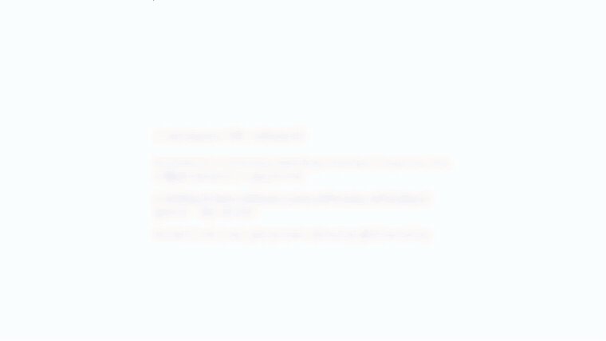
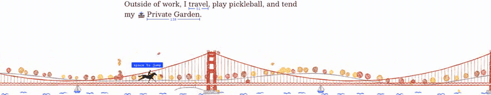
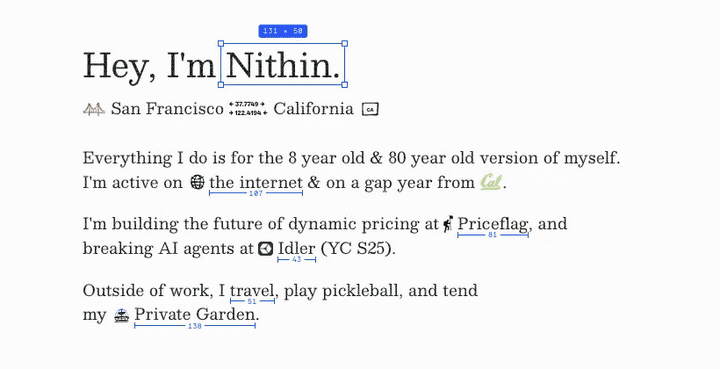
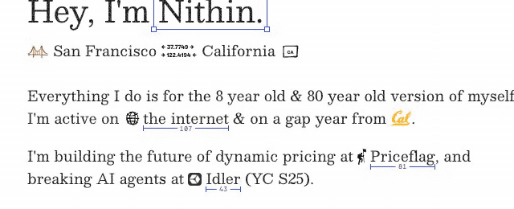
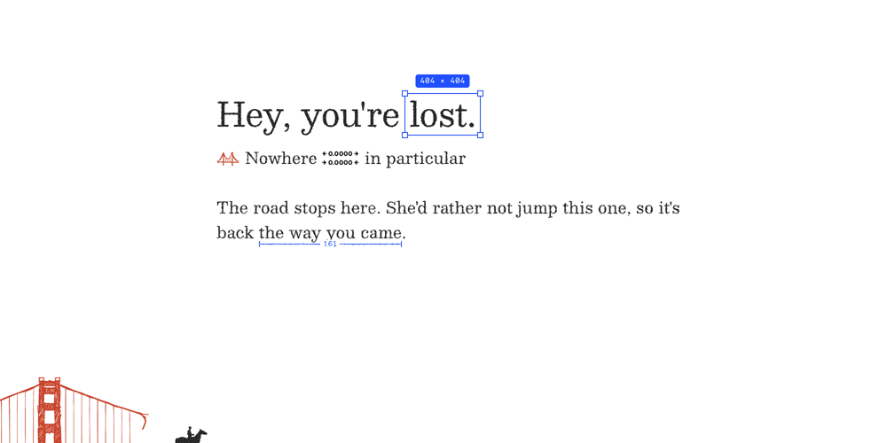
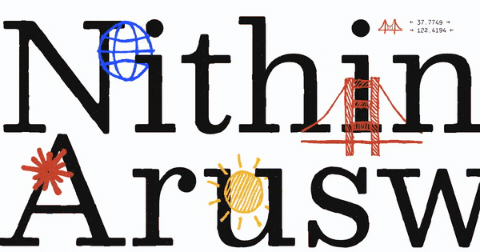

<h1 align="center">sf-portfolio</h1>

<p align="center">
  A personal site with a horse from 1878 running across a hand-drawn Golden Gate.<br />
  Press space and she jumps.
</p>

<p align="center">
  <a href="https://nithinaruswamy.com"><b>See it live → nithinaruswamy.com</b></a>
</p>

<p align="center">
  <a href="https://github.com/nithinaru/sf-portfolio/stargazers"></a>
  <a href="LICENSE"></a>
  
  
</p>

<p align="center">
  <a href="https://nithinaruswamy.com">
    
  </a>
</p>

<p align="center">
  <b>If you like it, a ⭐ helps other people find it.</b>
</p>

---

## What's in here

One page, nothing scrolls, and almost everything on it is drawn in code rather than loaded as an image.

### 🐎 A horse you can make jump

<p align="center">
  
</p>

- **The horse** is Sallie Gardner, from Eadweard Muybridge's *The Horse in Motion* (1878, public domain). Eleven of his photographs in one strip, played in a loop.
- **She runs for ever without going anywhere.** The bridge slides past at exactly the pace of her legs. Headlands, boats and Alcatraz slide more slowly behind.
- **Space to jump** (tap on a phone). She sinks, pushes off, tucks, reaches and lands. Clear a pumpkin and a counter starts; clip one and it tips over.
- **The bridge is not an image.** Towers, cables, hanger ropes, water and trees are [rough.js](https://roughjs.com) strokes from fixed seeds: hand-drawn in look, identical on every load.

### 📐 An opening borrowed from a design tool

The page arrives the way a frame looks when you select it. Cobalt measuring guides draw themselves around the text, colour sweeps through the words a line at a time, and the guides pull away.

- The name keeps its **selection box**, with its real size in pixels on a label. Click it and the label shuffles into "Email copied".
- Every link is underlined with a **dimension line** that has its own length written on it.

### 🔍 Previews that sharpen as they arrive

<p align="center">
  
</p>

Hover a link and a card of that site appears as a handful of big pixels, sharpens in six quick steps, then plays a short clip. It trails the pointer with a slight tilt while the rest of the page blurs back.

### ✍️ A dock of hand-drawn marks

<p align="center">
  
</p>

"The internet" opens into a row of drawn social marks that swell under the pointer.

### 🖨️ Ink, not pixels

Text and horse are run through SVG filters that wobble the edges and drop specks out of the ink, so type looks printed. The horse gets a different printing on every frame, so her grain moves with her.

### 🌉 A 404 where the road runs out

<p align="center">
  
</p>

### 🎞️ A link preview that boils

<p align="center">
  
</p>

The share image is the name as big as it goes, with four drawings woven through the letters. Apps that play video in link previews get a clip where each drawing is redrawn about eight times a second, the way hand-drawn animation flickers.

---

## Make it yours

Fork it, then change these and you have your own:

| To change | Edit |
|---|---|
| The greeting, name and every sentence and link | `GREETING`, `NAME` and `COPY` at the top of [`src/pages/index.tsx`](src/pages/index.tsx) |
| Site title, description, email, handle | [`src/utils/site.ts`](src/utils/site.ts) |
| What search engines are told about you | [`src/utils/constants.ts`](src/utils/constants.ts) and [`src/utils/structured-data.ts`](src/utils/structured-data.ts) |
| The hover previews | Drop a `.webp` (and an optional `.mp4`) in `public/images/previews` and name it in `COPY` |
| The scene along the bottom | [`src/components/scenes.tsx`](src/components/scenes.tsx): swap the bridge for your own city |
| Colours and type | `--blue` and `--ink` in [`src/globals.css`](src/globals.css); fonts in [`src/components/options.tsx`](src/components/options.tsx) |
| Share image, favicons | `public/og.png`, `public/og.mp4`, and the icons beside them |

```bash
npm install
```

```bash
npm run dev
```

Then open http://localhost:3000. `npm run lint` runs Biome.

## How it's built

| | |
|---|---|
| **Framework** | Next.js 16 (pages router), React 19 with the React Compiler, TypeScript |
| **Styling** | Tailwind 4 and one hand-written stylesheet |
| **Drawing** | rough.js for every sketched line; SVG filters for the ink |
| **Type** | Besley, Necto Mono and Apfel Grotezk |
| **Dependencies** | Four: Next, React, React DOM, rough.js |

<details>
<summary><b>Where things are</b></summary>

| File | What it holds |
|---|---|
| [`src/pages/index.tsx`](src/pages/index.tsx) | The page, its words and links, and the opening |
| [`src/components/scenes.tsx`](src/components/scenes.tsx) | The horse, the bridge, the jump, the pumpkins and the leaves |
| [`src/components/ruler-intro.tsx`](src/components/ruler-intro.tsx) | The measuring guides |
| [`src/components/pixel-preview.tsx`](src/components/pixel-preview.tsx) | The hover previews |
| [`src/components/dock.tsx`](src/components/dock.tsx) | The row of social marks |
| [`src/components/sketch.tsx`](src/components/sketch.tsx) | The small drawn signs: bridge, globe, fountain, underlines |
| [`src/components/options.tsx`](src/components/options.tsx) | Fonts and the ink filters |
| [`src/pages/404.tsx`](src/pages/404.tsx) | The page for an address that isn't one |
| [`src/globals.css`](src/globals.css) | All the styles |

</details>

A few details worth knowing:

- **Nothing scrolls.** The text scales to fit whatever window it's in, and the scene shrinks on short screens.
- **Reduced motion is respected.** With it on, the horse stands still and the opening is skipped.
- **It works on a phone.** Tap to jump, and tap "the internet" to open the dock.

## Credits

- The horse: Eadweard Muybridge, *The Horse in Motion*, 1878.
- Fonts: Besley by indestructible type*, Necto Mono and Apfel Grotezk by Collletttivo.
- This repo started from [Cody Miller's site](https://looskie.com). Everything on the page has been rewritten since; some of the project setup still traces back to it.

## Licence

The code is [MIT](LICENSE): take it, learn from it, build your own. The words, my name and likeness, the share image and the screenshots of my projects are mine, so please swap those out.

---

<p align="center">
  Built by <a href="https://nithinaruswamy.com">Nithin Aruswamy</a> · <a href="https://x.com/nithinaru">@nithinaru</a><br />
  <b>If this gave you an idea for your own site, leave a ⭐ and show me what you make.</b>
</p>
